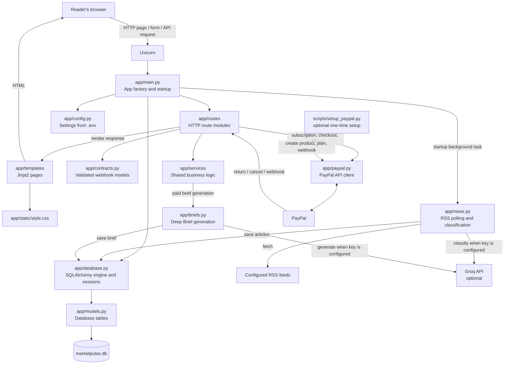

# MarketPulse AI

MarketPulse AI is a small FastAPI news app for Indian market coverage. It imports articles from configurable RSS feeds, classifies stories by category and sentiment, and presents them in a searchable, responsive news feed.

## Features

- Browse stories by category, including an All view.
- Filter by bullish, bearish, or neutral sentiment and search story text.
- See a featured headline and browse the rest of the selected news feed.
- Create an account and access delayed stories with a Pro subscription.
- Purchase a one-time Deep Brief for an article.
- Use Groq for story classification and brief generation; brief generation has a factual fallback when no API key is configured.
- Store accounts, articles, subscriptions, and briefs in SQLite by default.

## Requirements

- Python 3.10 or later
- Windows PowerShell examples below; other shells can use equivalent commands.
- Optional: a Groq API key for AI classification and Deep Brief generation.
- Optional: PayPal sandbox or live API credentials for payments.

## Install

Open PowerShell in the project directory:

```powershell
cd C:\Users\Asus\Desktop\market_pulse
py -3 -m venv .venv
.\.venv\Scripts\python.exe -m pip install -r requirements.txt
Copy-Item .env.example .env
```

Edit `.env` for your setup. At minimum, set a private `APP_SECRET_KEY` for session signing. `DATABASE_URL` defaults to the local SQLite database `marketpulse.db`; the default news feeds are listed in `.env.example`.

### Optional integrations

- **Groq:** Set `GROQ_API_KEY` to enable AI story classification and generated Deep Briefs. Without it, stories use keyword-based classification and Deep Briefs use a factual fallback.
- **PayPal:** Set `PAYPAL_MODE` to `sandbox` or `live`, then configure `PAYPAL_CLIENT_ID`, `PAYPAL_CLIENT_SECRET`, `PAYPAL_PLAN_ID`, and `PAYPAL_WEBHOOK_ID`. Use PayPal sandbox buyer accounts when testing in sandbox mode.
- `BASE_URL` must be the public root URL of the running app for PayPal return links and webhooks. It must not include a path or query string.

For local development, the default is `http://localhost:8000`. To test PayPal or access the app over a temporary public HTTPS URL, run the app and a Cloudflare Quick Tunnel in two separate PowerShell windows.

### Run the app with Cloudflare Tunnel

1. Make sure `cloudflared` is installed and `.env` exists.
2. In **PowerShell window 1**, start the app:

   ```powershell
   cd C:\Users\Asus\Desktop\market_pulse
   .\.venv\Scripts\python.exe -m uvicorn app.main:app --host 127.0.0.1 --port 8000
   ```

3. In **PowerShell window 2**, start the tunnel:

   ```powershell
   cloudflared tunnel --url http://127.0.0.1:8000
   ```

4. Copy the HTTPS root URL printed by `cloudflared` (for example, `https://your-name.trycloudflare.com`). In `.env`, set `BASE_URL` to that root URL. Do not include a path such as `/subscribe/return` or any query parameters.
5. If Uvicorn was already running when you changed `BASE_URL`, stop it with **Ctrl+C** in window 1 and run the Uvicorn command again. Leave both windows running.
6. Open the tunnel's HTTPS URL in your browser. PayPal sandbox requires a sandbox buyer account.

When stopping, press **Ctrl+C** in both windows. Quick Tunnel URLs can change when recreated; update `BASE_URL` and restart the app each time. Do not use a temporary Quick Tunnel as a production deployment.

## Run

To run locally without a public tunnel, open PowerShell in the project directory and run:

```powershell
.\.venv\Scripts\python.exe -m uvicorn app.main:app --host 127.0.0.1 --port 8000
```

Open [http://127.0.0.1:8000](http://127.0.0.1:8000). Check the server health at [http://127.0.0.1:8000/healthz](http://127.0.0.1:8000/healthz).

Stop the server with **Ctrl+C** in the PowerShell window running Uvicorn.

## PayPal setup

The optional setup script creates a PayPal product, monthly plan, and webhook using the credentials and public HTTPS `BASE_URL` configured in `.env`:

```powershell
.\.venv\Scripts\python.exe -m scripts.setup_paypal
```

Copy the printed `PAYPAL_PLAN_ID` and `PAYPAL_WEBHOOK_ID` values into `.env`, then restart the app. Run this only when you intend to create these PayPal resources. Keep all credentials private and never commit `.env`.

## Tests

Run the test suite with:

```powershell
.\.venv\Scripts\python.exe -m pytest -q
```

## Lint, format, and type-check baseline

The project uses Ruff for linting and formatting and Pyright in strict mode for static type checking. Tool settings live in `pyproject.toml`; development tools are listed in `requirements-dev.txt`.

Install the development tools:

```powershell
.\.venv\Scripts\python.exe -m pip install -r requirements-dev.txt
```

Run the checks individually:

```powershell
.\.venv\Scripts\python.exe -m compileall -q app scripts tests
.\.venv\Scripts\ruff.exe check --output-format json app scripts tests
.\.venv\Scripts\ruff.exe format --check --diff app scripts tests
.\.venv\Scripts\pyright.exe --outputjson
```

To save a timestamped audit log for each check in an ignored `audit-logs` directory:

```powershell
$stamp = Get-Date -Format "yyyyMMdd-HHmmss"
New-Item -ItemType Directory -Force audit-logs | Out-Null
.\.venv\Scripts\python.exe -m compileall -q app scripts tests 2>&1 | Tee-Object "audit-logs\syntax-$stamp.log"
.\.venv\Scripts\ruff.exe check --output-format json app scripts tests 2>&1 | Tee-Object "audit-logs\ruff-lint-$stamp.json"
.\.venv\Scripts\ruff.exe format --check --diff app scripts tests 2>&1 | Tee-Object "audit-logs\ruff-format-$stamp.log"
.\.venv\Scripts\pyright.exe --outputjson 2>&1 | Tee-Object "audit-logs\pyright-$stamp.json"
```

The first strict audit is expected to expose existing issues before business-logic cleanup begins. Review and record the baseline; do not auto-fix or suppress existing findings as part of setup. Run format checks (not `ruff format`) so this audit does not rewrite files.

## Local hooks and CI quality gates

Install the development tools, then enable the repository's pre-commit hooks:

```powershell
.\.venv\Scripts\python.exe -m pip install -r requirements-dev.txt
.\.venv\Scripts\pre-commit.exe install
.\.venv\Scripts\pre-commit.exe run --all-files
```

The hooks run Gitleaks secret scanning, reject staged `.env` files (except `.env.example`), run Ruff linting and formatting checks, and reject new strict Pyright diagnostics. The project currently has an approved Pyright baseline; improve it as code is fixed, and review any baseline change before committing:

```powershell
.\.venv\Scripts\python.exe scripts\check_pyright.py
.\.venv\Scripts\python.exe scripts\check_pyright.py --update-baseline
```

GitHub Actions runs lint, changed-file formatting checks, strict typing against that baseline, tests, dependency auditing, and Gitleaks secret scanning for pull requests and pushes to `main`. A second job runs tests on Python 3.10 and 3.13. In GitHub repository settings, enable branch protection for `main` and require both **Quality and security** and **Tests (Python 3.10)** / **Tests (Python 3.13)** before merging. Secret scanning in CI protects pushes after they reach GitHub; keep `.env` local and never add credentials to commits.

## How the project works

The app has two main flows: a background news-import flow and an HTTP request flow. Optional Groq and PayPal integrations are called only for the features that need them.



### File responsibilities

- `requirements.txt` lists the Python packages used by the app and its tests.
- `requirements-dev.txt` lists the lint, formatting, type-checking, pre-commit, and dependency-audit tools.
- `.pre-commit-config.yaml` configures local commit quality checks.
- `.github/workflows/ci.yml` runs CI, dependency auditing, and secret scanning.
- `pyright-baseline.json` records the reviewed strict type-check baseline; `scripts/check_pyright.py` rejects new diagnostics.
- `.env.example` documents configuration names and safe local-development defaults. Copy it to `.env` and add your own credentials there; `.env` is ignored by Git.
- `app/__init__.py` marks `app` as a Python package.
- `app/main.py` creates the FastAPI application, starts and stops the background news poller, prepares the database, and wires sessions, templates, middleware, and route modules.
- `app/routes/pages.py`, `auth.py`, `subscriptions.py`, `briefs.py`, and `webhooks.py` define HTTP handlers, validate request inputs, and translate service outcomes into pages, redirects, or API responses.
- `app/routes/types.py` shares the typed session dependency and PayPal client-factory contracts used by route factories.
- `app/contracts.py` defines validated Pydantic models for incoming PayPal webhook events.
- `app/services/common.py` contains shared account, article visibility, flash-message, and presentation helpers.
- `app/services/payments.py` contains payment amount/link helpers and verified-webhook business logic.
- `app/config.py` loads and validates application settings such as database URL, RSS feeds, Groq key, public base URL, and PayPal configuration.
- `app/database.py` creates the SQLAlchemy engine and session factory and provides database sessions to routes.
- `app/models.py` defines the SQLAlchemy tables for users, news articles, purchased briefs, PayPal orders and subscriptions, and processed payment events.
- `app/news.py` fetches configured RSS feeds, normalizes article text and dates, classifies new articles with Groq or keyword rules, then stores them through SQLAlchemy. The poller runs periodically while the app is running.
- `app/briefs.py` generates the four-section Deep Brief with Groq when configured, otherwise uses a factual fallback, and persists the result.
- `app/paypal.py` encapsulates PayPal API calls for subscription plans, checkout, cancellation, and webhook-signature verification.
- `app/security.py` provides password hashing and password verification used by the signup and login routes.
- `app/templates/index.html` renders the news home page, category navigation, story grid, filters, account controls, and subscription information.
- `app/templates/auth.html` renders signup and login forms.
- `app/templates/brief.html` renders a purchased Deep Brief.
- `app/static/style.css` styles the pages and responsive layouts.
- `scripts/setup_paypal.py` optionally creates a PayPal product, monthly plan, and webhook, then prints the IDs to place in `.env`.
- `tests/test_news.py` tests RSS parsing, polling, and article classification.
- `tests/test_paypal.py` tests subscription, checkout, and webhook flows with a fake PayPal client.
- `tests/test_paypal_client.py` tests PayPal API-client request behavior.
- `tests/test_step1.py` tests core routes, accounts, front-page behavior, and health checks.

### Typical request and background sequences

1. Uvicorn imports `app.main:app`; `app/config.py` loads settings and `app/database.py` provides database access.
2. On startup, `app/main.py` initializes database tables and launches `app/news.py` in the background.
3. The poller reads RSS feed URLs from configuration, adds new classified stories to the database, and repeats on its polling interval.
4. A browser request reaches the relevant module in `app/routes/`. The route uses shared logic in `app/services/`, reads or updates records through `app/database.py` and `app/models.py`, then returns JSON, a redirect, or a Jinja-rendered template.
5. The browser applies interactive search and sentiment filters, while `app/static/style.css` controls how the story grid responds to different screen sizes.
6. For a Deep Brief or payment, route handlers call the appropriate service or integration module (`app/briefs.py` or `app/paypal.py`), which uses configured services and persists verified results.

## Project layout

```text
app/
  main.py
  contracts.py
  config.py
  database.py
  models.py
  news.py
  briefs.py
  paypal.py
  security.py
  routes/
    auth.py
    briefs.py
    pages.py
    subscriptions.py
    types.py
    webhooks.py
  services/
    common.py
    payments.py
  templates/
  static/
scripts/
  setup_paypal.py
tests/
  test_news.py
  test_paypal.py
  test_paypal_client.py
  test_step1.py
requirements.txt
.env.example
README.md
```

## Screenshot

Save the project screenshot as `screenshots/marketpulse-home.png` from the repository root, creating the `screenshots` folder if needed. Then add it to this section:

```markdown

```

## Security and payments

Do not share or commit `.env` or its API credentials. Sandbox and live PayPal credentials and plans are separate; use the matching mode and credentials. This application displays market news for information only and does not provide investment advice.
